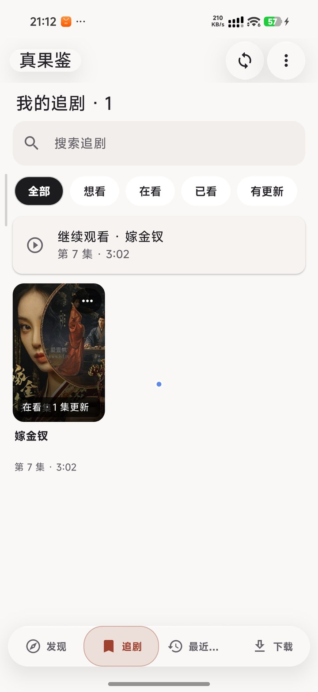
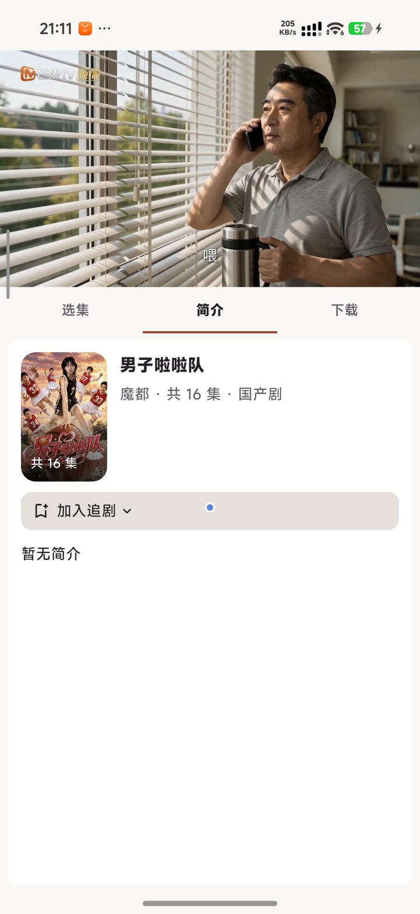
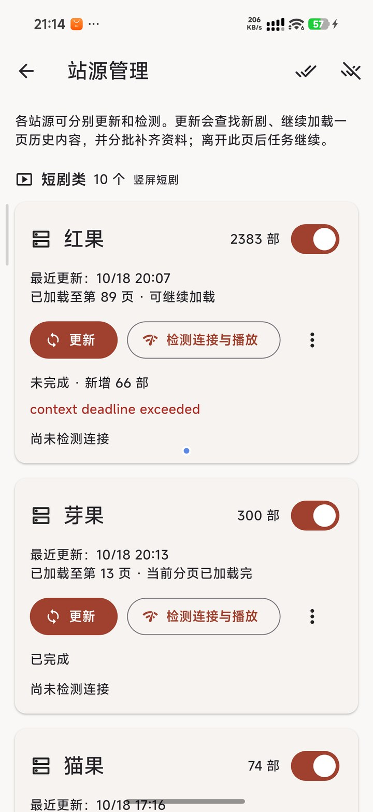

<div align="center">

# 真果鉴

**一款 Flutter + Go 打造的多端短剧 / 影视聚合播放器**

站源请求 · 解析 · 播放 · 下载，全部在设备本地完成，无自建服务端、无账号依赖。


</div>

---

<div align="center">

</div>

## ✨ 特色

** 多源聚合，一站看全 **
- 内置 **25 个站源**（红果 / 魔都 / 影视工厂 / 青空……），覆盖短剧、电影、剧集、综艺、动漫
- 站源分类管理，健康度一目了然：剧库数量、更新时间、连接与播放检测、一键全开 / 全关
- 排行榜、分类筛选、热度排序，发现好剧不用东奔西走

** 沉浸式播放体验 **
- **竖屏短剧信息流**：上下滑切集，滑过首尾集自动跳上 / 下一步剧，像刷短视频一样刷剧
- **横版播放器**（libmpv 硬解）：多线路切换、清晰度选择、倍速、选集、画中画
- 自动连播 + 下一集预加载，追剧永不断档；播放进度自动记忆，随时接着看
- 弹幕支持（红果源剧集），带加载状态提示

** 追剧与下载 **
- 追剧状态管理：想看 / 在看 / 已看 / 有更新，更新角标提醒
- **多选批量下载**：m3u8 分片下载、AES-128 解密、断点续传、自动合并
- 下载完成后可自动导出 **Emby 媒体库**格式（视频 + 海报 + URL 元数据）

** 设备互联 **
- 同一局域网内多台设备**自动同步追剧进度**、**推送播放**到另一台设备
- 多用户体系：家人各看各的，互不打扰；管理员 PIN 保护受限站源

** 为多端而设计 **
- 手机（竖屏瓷面玻璃 UI）、Windows 桌面、**Android TV 遥控器焦点导航**全套适配
- 界面模式随时切换，TV 与手机体验一致

## 📸 应用预览

| 追剧 | 详情与播放 | 站源管理 |
|:---:|:---:|:---:|
|  |  |  |

| 全屏播放器 |
|:---:|
|  |

## 📥 下载安装

前往 [**Releases**](../../releases) 页面下载对应平台的安装包：

| 平台 | 文件 | 说明 |
| --- | --- | --- |
| Android（推荐） | `zhenguojian-<版本>-arm64-v8a.apk` | 近 8 年主流机型 |
| Android（旧机） | `zhenguojian-<版本>-armeabi-v7a.apk` | 32 位老设备 |
| Android 模拟器 | `zhenguojian-<版本>-x86_64.apk` | 模拟器 / 平板 |
| Windows | `zhenguojian-<版本>-windows-x64.zip` | 解压即用，无需安装 |

**安装步骤**
1. Android：下载 APK → 允许「安装未知应用」→ 安装（首次启动如被系统拦截，选择「仍要安装」）
2. Windows：解压 zip → 运行 `duanju_app.exe`

## 🚀 快速上手

1. **更新剧库**：右上角 `⋯` → **站源管理** → 点各站源的「更新」拉取最新剧目
2. **浏览**：首页顶部分类横滑切换（全部 / 国产剧 / 韩国剧 / 欧美剧…），点剧卡直接进入播放
3. **追剧**：播放页点「加入追剧」，在底栏 **追剧** 页管理状态、接收更新提醒
4. **开启更多站源**：部分受限站源默认关闭，需在 **设置 → 用户管理** 先设置管理员密码，再到站源管理页开启
5. **下载**：剧卡右上角 `⋯` 菜单 → **多选下载**；下载偏好与目录在设置中调整
6. **设备互联**：多台设备连同一 Wi-Fi，在 **设置 → 设备互联** 中同步追剧 / 推送播放

> 💡 弹幕仅红果源剧集提供；播放失败时可在播放页点「站源诊断」定位问题，或在站源管理页跑「检测连接与播放」。

## 🧩 技术架构

```
┌─────────────────────────────────────────┐
│   Flutter UI（手机 / Windows / TV 三端）  │
├─────────────────────────────────────────┤
│   FFI 桥接                               │
├─────────────────────────────────────────┤
│   Go 原生核心 (libduanju_core)           │
│   站源插件注册表 · HLS/DASH 解析          │
│   m3u8 AES-128 加密代理 · 分片下载合并     │
│   局域网设备互联协议                       │
├─────────────────────────────────────────┤
│   media_kit (libmpv) 播放内核             │
└─────────────────────────────────────────┘
```

- **站源插件化**：所有站源实现统一的 `Provider` 契约（目录 / 详情 / 搜索 / 媒体解析），注册进 `native/provider` 注册表，新增站源零侵入
- **无服务端架构**：请求、解析、缓存、下载全部在本地完成，隐私数据不出设备
- 详细的架构与站源接入文档见 [docs/DEVELOPMENT.md](docs/DEVELOPMENT.md)
- **想新增站源？** 五步接入指南（Spec 登记 → 能力实现 → 注册聚合 → 验收）见 [docs/SOURCE-GUIDE.md](docs/SOURCE-GUIDE.md)

## 🛠 从源码构建

依赖：Flutter 3.47+ · Go 1.27+ · JDK 17 · Android SDK / NDK

```bash
# 1. 安装依赖
flutter pub get

# 2. 构建 Android（真果鉴 = 全站源变体）
flutter build apk --release --split-per-abi --dart-define=ALL_SOURCES=true

# 3. 构建 Windows
flutter build windows --dart-define=ALL_SOURCES=true

# 4. 一键打包（自动校验产物并按 {名称-版本-ABI} 命名）
python scripts/package_release.py --platform android --all-sources
```

> 变体说明：`ALL_SOURCES=true` 构建为**真果鉴**（25 源）；不传该参数构建为**红果鉴**（默认单源精简版）。Go 原生核心需先行编译：在 `native` 目录执行 `go build ./core`，Android / Windows 交叉编译命令见 [docs/DEVELOPMENT.md](docs/DEVELOPMENT.md)。

## ⚠️ 免责声明

- 本项目为个人学习与技术交流用途，不存储、不上传任何影视内容
- 所有播放内容均来自公开网络的第三方站源，其可用性与合法性由站源方负责
- 如内容侵犯了您的权益，请联系相应站源处理；请支持正版影视

---

<div align="center">

如果这个项目对你有帮助，欢迎点一个 **Star** ⭐

</div>
